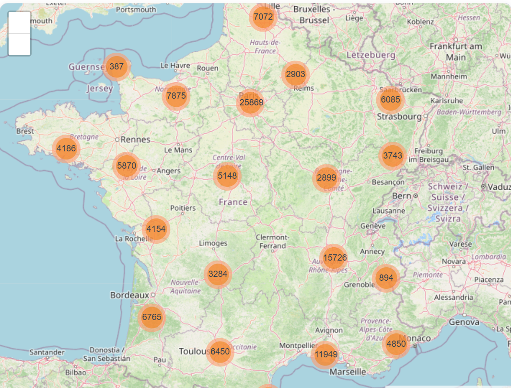

# Analyse spatiale et statistique des bornes de recharge électrique en France

### Projet Data Analysis | R • Shiny • Statistiques • Cartographie interactive

**Application interactive :** [https://lnkd.in/eA8HjK5y](https://celiaissaoun.shinyapps.io/bornes_de_recharge/) 

## 1. Présentation du projet

Ce projet universitaire a été réalisé dans le cadre du **Master 2 Statistiques Appliquées et Analyse Décisionnelle (SAAD)** à l'Université de Caen Normandie.

Il porte sur l'analyse, la préparation et la visualisation de données relatives aux infrastructures de recharge pour véhicules électriques en France.

L'objectif principal est d'étudier la répartition géographique des bornes de recharge, d'explorer leurs caractéristiques et d'analyser leur accessibilité par rapport à différents points d'intérêt.

Pour faciliter l'exploitation des données et la restitution des résultats, une **application web interactive développée avec R Shiny** permet aux utilisateurs de réaliser des explorations géographiques et statistiques à travers différentes fonctionnalités.

## 2. Objectifs du projet

- Collecter, nettoyer et préparer les données relatives aux bornes de recharge.
- Explorer les caractéristiques des infrastructures de recharge.
- Analyser la répartition géographique des bornes sur le territoire français.
- Identifier les zones de concentration à l'aide de cartes de chaleur.
- Étudier l'accessibilité des bornes par rapport aux points d'intérêt.
- Développer une application interactive facilitant l'exploration et la visualisation des résultats.

## 3. Technologies et outils utilisés

| Technologie | Utilisation |
|---|---|
| R | Traitement, analyse et manipulation des données |
| R Shiny | Développement de l'application web interactive |
| dplyr | Nettoyage, transformation et filtrage des données |
| Leaflet | Création de cartes géographiques interactives |
| sf | Manipulation des données spatiales et calcul des distances |
| osmdata | Récupération des points d'intérêt OpenStreetMap |
| OpenStreetMap | Données géographiques et fonds cartographiques |
| RStudio | Développement et tests de l'application |
| shinyapps.io | Hébergement de l'application |
| GitHub | Partage du code source et documentation du projet |

## 4. Méthodologie

### 4.1. Préparation et nettoyage des données

La première étape consiste à préparer les jeux de données afin de garantir leur qualité et leur exploitation dans les analyses.

Les traitements comprennent notamment :

- L'importation des différentes sources de données.
- La vérification des types et des formats des variables.
- Le traitement des valeurs manquantes et des incohérences.
- La conversion des coordonnées géographiques.
- L'harmonisation des codes géographiques.
- La préparation des données pour les analyses statistiques et spatiales.

### 4.2. Analyse exploratoire

L'analyse exploratoire permet d'étudier les caractéristiques des infrastructures de recharge et d'identifier les principales tendances observées dans les données.

Les résultats sont restitués à travers des visualisations et des représentations cartographiques.

### 4.3. Analyse spatiale

L'analyse spatiale repose sur l'exploitation des coordonnées géographiques des bornes de recharge.

Elle permet notamment de représenter leur localisation, d'explorer leur concentration géographique et de calculer les distances entre les infrastructures et différents points d'intérêt.

## 5. Fonctionnalités de l'application R Shiny

### 5.1. Visualisation géographique des bornes de recharge

Cette fonctionnalité permet de visualiser les bornes de recharge sur une carte interactive de la France.

L'utilisateur peut explorer les infrastructures à l'aide de filtres et consulter leurs caractéristiques, notamment :

- Le nom de la station.
- L'adresse de la station.
- La puissance nominale.
- Le type de prise disponible.

**Aperçu de la carte interactive :**



### 5.2. Analyse de la concentration spatiale

Une carte de chaleur permet de visualiser les concentrations géographiques des infrastructures de recharge.

L'utilisateur peut filtrer les données selon :

- La région.
- Le département.
- La puissance minimale.
- Le type de prise.

Cette représentation facilite l'identification des zones où les infrastructures sont les plus présentes.

La carte de chaleur utilise les localisations des bornes et une pondération par leur puissance nominale. Elle ne constitue pas une estimation de densité à noyau au sens statistique strict.

**Aperçu de la carte de chaleur :**


### 5.3. Analyse des distances et de l'accessibilité

Ce module permet d'étudier la proximité des bornes de recharge avec différents points d'intérêt issus d'OpenStreetMap.

Les catégories disponibles comprennent :

- Les parcs.
- Les restaurants.
- Les hôpitaux.
- Les centres commerciaux.
- Les autoroutes.

L'utilisateur sélectionne une commune et une catégorie de point d'intérêt.

L'application récupère les données géographiques correspondantes, puis calcule la distance minimale entre chaque borne et les points d'intérêt identifiés.

Les résultats sont présentés sous forme de carte et de tableau.

**Indicateurs calculés :**

- Distance minimale en kilomètres.
- Temps théorique estimé à partir d'une vitesse de référence de 50 km/h.
- Informations descriptives des stations.

Les distances correspondent à des distances géométriques directes et non à des itinéraires routiers. Les temps affichés sont donc des estimations théoriques.

**Aperçu de l'analyse des distances :**


### 5.4. Analyses et visualisations statistiques

L'application permet également d'explorer les données à travers des représentations statistiques destinées à faciliter leur interprétation.

Ces visualisations contribuent à mettre en évidence les caractéristiques et les différences observées entre les infrastructures étudiées.

**Aperçu des visualisations statistiques :**


## 6. Structure du projet

L'application est organisée autour de plusieurs modules R Shiny, permettant de séparer les fonctionnalités et de faciliter la maintenance du code.

```text
analyse-bornes-recharge-france/
│
├── app.R
│
├── code_RSHINY/
│   ├── mod_visualisation.R
│   ├── mod_kernel.R
│   ├── mod_distance.R
│   └── ...
│
├── images/
│   ├── carte_bornes.png
│   ├── carte_kernel.png
│   ├── analyse_distances.png
│   └── analyse_statistique.png
│
└── README.md
```

Cette structure est indicative et doit être adaptée à l'organisation réelle des fichiers du projet.

## 7. Application interactive en ligne

L'application est accessible depuis un navigateur web grâce à son déploiement sur shinyapps.io.

**[Ouvrir l'application R Shiny — Bornes de recharge en France](https://celiaissaoun.shinyapps.io/bornes_de_recharge/)**

L'interface permet d'explorer les données et d'interagir directement avec les cartes et les résultats des analyses.

Certaines fonctionnalités nécessitent une connexion à des services externes, notamment OpenStreetMap et Overpass API.

## 8. Compétences mobilisées

Ce projet m'a permis de mettre en pratique et de développer plusieurs compétences :

**Data Analysis**
- Préparation et nettoyage des données.
- Analyse exploratoire.
- Exploitation et interprétation de données géographiques.

**Analyse spatiale**
- Manipulation des coordonnées géographiques.
- Représentation cartographique.
- Calcul des distances spatiales.
- Analyse de la concentration géographique.

**Développement et visualisation**
- Programmation en R.
- Développement d'une application modulaire avec Shiny.
- Création de visualisations interactives.
- Intégration de données géographiques externes.
- Déploiement d'une application web.

## 9. Perspectives d'amélioration

Plusieurs évolutions peuvent être envisagées :

- Intégrer des indicateurs supplémentaires d'accessibilité.
- Étudier les disparités territoriales dans la répartition des infrastructures.
- Comparer les infrastructures de recharge avec des indicateurs démographiques.
- Optimiser les performances de chargement des données géographiques.
- Intégrer des distances routières et des temps de trajet réels.

## 10. Auteur

**Celia ISSAOUN**

Diplômée du Master 2 Mathématiques appliquées, statistiques — parcours Statistiques Appliquées et Analyse Décisionnelle (SAAD), Université de Caen Normandie.

**Domaines de compétences :** Data Analysis, statistiques appliquées, Business Intelligence, automatisation et visualisation de données.

**Technologies :** Python, R, SQL, Power BI, SAS, Shiny, Streamlit.

**GitHub :** [celia-issaoun](https://github.com/celia-issaoun)


